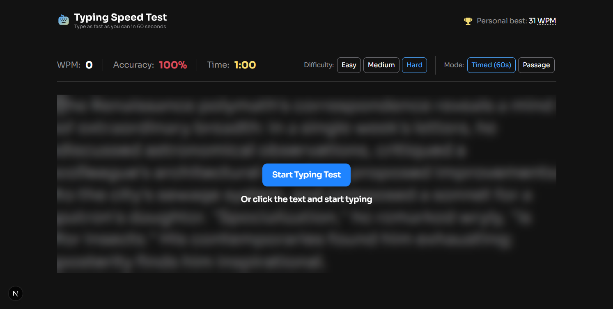

# Frontend Mentor - Typing speed test

This is a solution to the [Typing speed test](https://www.frontendmentor.io/challenges/typing-speed-test). Frontend Mentor challenges help you improve your coding skills by building realistic projects.

## Table of contents

- [Overview](#overview)
  - [The challenge](#the-challenge)
  - [Screenshot](#screenshot)
  - [Links](#links)
- [My process](#my-process)
  - [Built with](#built-with)
  - [What I learned](#what-i-learned)
- [Author](#author)

## Overview

### The challenge

Your users should be able to:

- Start a test by clicking the start button or by clicking the passage and typing
- Select a difficulty level (Easy, Medium, Hard) for passages of varying complexity
- Switch between "Timed (60s)" mode and "Passage" mode (timer counts up, no limit)
- Restart at any time to get a new random passage from the selected difficulty
- See real-time WPM, accuracy, and time stats while typing
- See visual feedback showing correct characters (green), errors (red/underlined), and cursor position
- Correct mistakes with backspace (original errors still count against accuracy)
- View results showing WPM, accuracy, and characters (correct/incorrect) after completing a test
- See a "Baseline Established!" message on their first test, setting their personal best
- See a "High Score Smashed!" celebration with confetti when beating their personal best
- Have their personal best persist across sessions via localStorage
- View the optimal layout depending on their device's screen size
- See hover and focus states for all interactive elements

### Screenshot

### Links

- Solution URL: https://github.com/JairRaid/typing-speed-test
- Live Site URL:

## My process

### Built with

- Semantic HTML5 markup
- React
- Next js
- Typescript
- Tailwind
- Flexbox
- CSS Grid
- Mobile-first workflow

### What I learned

I learned to:

- Build an application with Next.js and understand its project structure and file-based routing.
- Create reusable React components and use hooks to manage state and user interactions.
- Use TypeScript to define types for data, props, and state.
- Create responsive layouts and interactive states with Tailwind CSS.
- Track typing input and calculate WPM, accuracy, and results in real time.
- Persist a personal best between visits using `localStorage`.

## Author

- Email: rakotonirainyriija@gmail.com
- Facebook: https://web.facebook.com/jair.rakoto.3/
